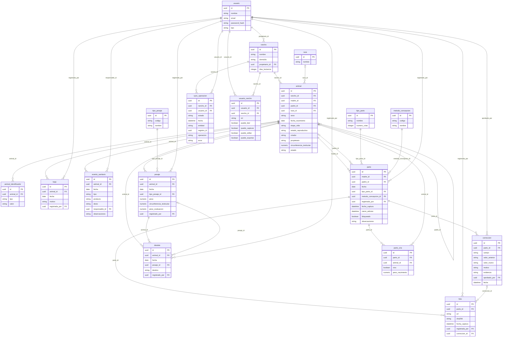

# Modelo ER de registro de OVIUM

Esquema implementado por las migraciones 0001–0004. Los IDs son UUID del cliente.

Las mediciones usan kg (peso y peso_evaluacion) y cm (circunferencia_testicular).
El campo animal.circunferencia_testicular se conserva por compatibilidad con la API existente;
el historial de mediciones se registra en pesaje.

rancho.dias_lactancia acepta 60, 75 o 90; el valor predeterminado es 75.
Sexo, etapa de vida y estado reproductivo son atributos independientes.
Los animales no se eliminan: se registra una baja. Las correcciones son registros anexos inmutables.
foto.parto_id enlaza la evidencia del nacimiento; correccion_id es opcional para evidencia de correcciones.
tipo_pesaje es un catalogo adicional a las entidades del resumen de arquitectura.
